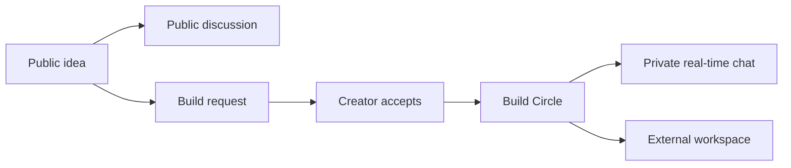

# AllDevs

**Discover an idea. Find collaborators. Build together.**

AllDevs is a GitHub-native collaboration product called **Build Circles**: public ideas, swipe discovery, creator-approved teams, and private real-time chat.

**Status:** Planning only. Next.js/TypeScript on Vercel, a TypeScript Workers API with Hono/Zod/REST, Cloudflare-owned GitHub login/sessions, and D1 product storage are selected. Vercel plan/costs are handled by the user. Auth integration, data-access tooling, chat details, policies, delivery, and launch remain unapproved. Development is blocked until explicit approval.

Updated: 2026-10-15.

- [CONTEXT.md](CONTEXT.md): plain-language product brief, agreed rules, open decisions, and glossary.
- [README.md](README.md): product summary, draft PRD, proposed architecture, costs, and verification plan.

Agreed means decided in discussion. Recommended means a proposal. To Decide means intentionally unresolved. Document consolidation is not implementation approval.

## Product Summary

| Area | Agreed Rule |
| --- | --- |
| Discovery | Swipe on public ideas, not people. Local-first by selected city/metro; no GPS required |
| Remote collaboration | Every idea accepts remote requests; no local-only creator setting |
| Public access | Anyone reads ideas/comments; GitHub sign-in is required to post, comment, or request to join |
| Membership | Right swipe sends a build request. Creator acceptance grants membership |
| Allowance | Only new build requests count, including equivalent forum actions. Views, skips, failed creation, and duplicate retries do not count |
| Coordination | Private built-in real-time circle chat or an external workspace |
| Beta | Free, including chat. No checkout, subscriptions, or paywalls |
| Future premium | Optional extra swipes after beta, not paid chat or circle membership |
| Pilot infrastructure | Cloudflare/backend and other non-Vercel infrastructure remain at USD 0; user handles Vercel plan/costs separately |
| Launch community | Explicitly deferred by the user; decide later |

## Problem Statement

Developers can publish code and ideas, but finding people who want to work on the same thing is a separate problem. GitHub activity and follower counts do not reveal willingness, availability, or fit for a new collaboration.

AllDevs focuses on moving from an idea to an agreed collaboration. Demand, repeat usage, and competitive differentiation are hypotheses, not validated market findings.

## Solution

1. Browse public ideas and discussion without signing in.
2. Use GitHub sign-in to post an idea, comment, or send a build request. Work evidence is optional; no minimum commits, followers, or repositories.
3. Discover ideas local-first, while allowing remote participation in every circle.
4. Swipe right to request collaboration; swipe left to skip without using allowance.
5. Let the creator choose collaborators instead of automatically enrolling everyone interested.
6. Coordinate in free private real-time chat during beta, or choose an external workspace.

**Recommended:** use the same idea posts for forum and swipe views, with accessible button alternatives. Track an agreed first building step, not just swipes. Required post fields and progress features remain open.

## User Stories

Draft stories based on agreed behavior. Safety/recovery stories describe required design considerations; their detailed policies and implementation are not yet approved.

1. As a visitor, I want to read ideas without signing in, so that I can assess the community before joining.
2. As a visitor, I want to read public discussion, so that I can understand an idea's context.
3. As a builder, I want to sign in with GitHub without activity thresholds, so that a new account is not excluded.
4. As a builder, I want to choose which work evidence I share, so that participation does not require a complete public activity history.
5. As a builder, I want to select a city or metro without GPS, so that discovery has local context without precise tracking.
6. As a creator, I want to post an idea without an existing repository, so that collaborators can help shape it early.
7. As a builder, I want to discover nearby ideas first, so that local collaboration is easier to find.
8. As a remote builder, I want to request collaboration on any geographically eligible idea, so that living elsewhere does not block me.
9. As a signed-in builder, I want to comment before joining, so that I can clarify expectations.
10. As a builder, I want to skip without using allowance, so that exploration is not penalized.
11. As a builder, I want a right swipe or equivalent forum action to send a build request, so that I can express interest consistently.
12. As a builder, I want only new requests to consume allowance, so that retries and failures do not charge extra units.
13. As a creator, I want to review and accept collaborators, so that interest is not automatic membership.
14. As a member, I want private real-time circle chat without payment in beta, so that we can coordinate together.
15. As a circle, I want an external coordination option, so that we can use a workspace we prefer.
16. As a member, I want exhausted swipe allowance not to revoke membership or chat, so that existing collaboration continues.
17. As a user, I want clear limit or outage states without a paid beta bypass, so that unavailable capacity is represented honestly.
18. As a member, I want reliable acknowledgment and reconnect behavior, so that I can tell whether a message was saved.
19. As a user, I want visibility, reporting, blocking, correction, and deletion policies, so that I can control my participation and address abuse.
20. As the operator, I want quota-aware controls and measurements, so that the backend stays within its hard-zero pilot budget while Vercel costs are handled separately.

## Implementation Decisions

The product rules, hosting split, Next.js/TypeScript frontend, Hono/Zod Workers REST API, Cloudflare session ownership, and D1 product database are agreed. Unless explicitly marked selected, the component details and module boundaries below are **recommended, not selected or implemented**. Test scope and delivery approval are still required.

### Technical Decision Register

Technical grilling resumed on 2026-10-15. Resolve one dependency-driving choice at a time, record the user's answer, and keep unapproved recommendations distinct from selections. Recruitment remains deferred.

| ID | Decision | Current Recommendation | Status |
| --- | --- | --- | --- |
| T1 | Hosting topology | Vercel frontend plus Cloudflare backend | Selected B, 2026-10-15 |
| T1a | Vercel plan and budget | Keep Vercel; the user handles its plan/costs separately from the zero-spend backend | User-managed, 2026-10-15; no specific purchase authorized |
| T2 | Frontend framework and rendering | Next.js App Router with TypeScript; server-render public pages and use client components for swiping/chat | Selected A, 2026-10-15 |
| T3 | API structure and validation | Cloudflare Workers with TypeScript, Hono routing, Zod runtime validation, and REST endpoints in a modular application | Selected A, 2026-10-15 |
| T4 | GitHub login and session ownership | Cloudflare owns the GitHub callback and revocable sessions; frontend consumes that identity | Selected A, 2026-10-15; library, storage, and transport remain open |
| T5 | Product database | Cloudflare D1 with SQLite relational records and explicit migrations | Selected A, 2026-10-15; access layer and session schema remain open |
| T5a | Data access and migration tooling | Drizzle ORM D1 adapter for queries; Drizzle Kit generates reviewed SQL; Wrangler applies migrations | Awaiting user decision; native D1 prepared SQL is the alternative |
| T6 | Chat transport and message storage | Hibernating WebSockets and per-circle SQLite-backed Durable Objects | Open |
| T7 | Consistency and limits | Atomic request counting, idempotency, authoritative membership, bounded chat usage | Detailed design open |
| T8 | Safety and observability | Server-side authorization, abuse controls, privacy-safe logs, quota circuit breakers | Detailed policies open |
| T9 | Tests and delivery | Behavior-scoped tests plus browser journeys; tooling and CI undecided | Open |

**T1 decision:** The user selected B: frontend on Vercel, backend/API and chat on Cloudflare. The Cloudflare-only recommendation was not selected. T2-T5 record the selected frontend, API stack, session owner, and product database. T5a, T6-T9, and detailed auth integration remain open. This does not authorize deployment or paid infrastructure.

**Vercel plan responsibility:** Official documentation checked on 2026-10-15 limits Hobby to personal, non-commercial use; commercial deployments require Pro or Enterprise. The user has stated they can handle Vercel, so retain the chosen host and leave its plan/eligibility/costs with the user. This is not confirmation of Hobby eligibility or authorization for the assistant to activate a paid plan. Verify the applicable plan before deployment without reopening the hosting choice during framework selection.

**T1a decision:** "Can handle Vercel" is recorded as a user-managed exception to the earlier all-in USD 0 target, not an unlimited spending approval. The Cloudflare/backend and other non-Vercel infrastructure remain under the zero-spend pilot constraint. No plan, price, purchase, deployment, or backend overage has been approved.

**T2 decision:** The user selected A: Next.js App Router with TypeScript on Vercel. Server-render public idea pages with per-idea sharing metadata; use client components for swiping, live chat, and other browser interactions. The React/Vite SPA alternative was not selected. Exact package versions, styling, client state tooling, and search-engine indexing policy remain undecided.

**Frontend boundary:** Next.js renders the website and reads Cloudflare APIs; it must not become a second authority for product writes, membership, allowance counting, or sessions. Cloudflare owns authentication and browser chat admission. The browser credential transport and any frontend proxy remain separate technical decisions. Private/member-specific responses must never enter a shared public cache; cache and revalidation policies need explicit design.

**T3 decision:** The user selected A: Cloudflare Workers with TypeScript, Hono routing/middleware, Zod runtime validation, and REST endpoints in one modular API application. The plain fetch-routing alternative was not selected. Keep domain operations separate from route handlers rather than creating a microservice fleet. TypeScript types alone do not validate untrusted JSON, and schema validation does not replace authorization. This does not select an auth library, database layer, chat protocol, or exact dependency versions.

**T4 decision:** The user selected A: Cloudflare owns GitHub OAuth callback handling, session creation/validation/revocation, and the identity used by API and chat admission. Next.js consumes that identity rather than creating an independent session authority. Next.js-owned authentication was not selected. This is an ownership decision, not selection of an auth library, session database, token format, cookie topology, or expiry policy.

**Auth integration still to design:** the auth library, GitHub app/scopes, session storage, expiry, logout, preview callbacks, origin checks, and browser credential transport remain open. Do not assume third-party cookies work between unrelated Vercel/Workers domains or that a shared custom domain already exists. Same-site subdomains or a narrowly scoped same-origin frontend proxy are candidates, not decisions. A library's GitHub provider support alone does not verify its Workers/database compatibility. OAuth tokens must stay server-side, and chat needs authenticated admission plus live-access revocation.

**T5 decision:** The user selected A: Cloudflare D1 for profiles, ideas, public comments, requests, memberships, and allowance records. Use relational constraints and explicit migrations; Workers access D1 through its native binding. MongoDB Atlas was not selected for product storage. This does not select the query library, auth adapter/session schema, or chat history storage, and does not establish free-tier capacity.

**D1 constraints checked on 2026-10-15:** Workers Free permits 500 MB per D1 database, 5 GB total account storage, 5 million rows read/day, and 100,000 rows written/day. A database processes queries one at a time; indexed queries, bounded scans, atomic request/allowance operations, and overload handling need validation. Index maintenance adds writes; exhausting read/write quotas causes query errors, not an unlimited free service. Chat history storage is a separate T6 decision, not an automatic duplicate copy into D1. D1 would be a candidate for durable sessions if its auth adapter is selected and verified; session storage is not approved by the ownership choice alone.

**T5a question:** Use Drizzle ORM with its D1 adapter and Drizzle Kit for SQL migration generation, or native D1 prepared statements with hand-written SQL migrations? Recommendation: Drizzle for typed schema/query code, reviewed generated SQL, and Wrangler as the migration application authority. Native SQL is a valid lower-dependency alternative but requires more manual schema/query maintenance. Neither option replaces Zod input validation, authorization, or database constraints.

**Proposed migration workflow, not approved:** generate SQL, review it, apply it to local/test D1, verify behavior, and apply the same versioned files to the intended remote database only after approval. Use one applied-migration history, managed by Wrangler, rather than also applying the same migrations through Drizzle's separate runner. Match Wrangler's migration directory/pattern to the generated layout. Do not use direct schema push as an unreviewed production migration path. Pin compatible package versions later; an RC example in upstream docs is not approval to adopt prereleases. Atomic multi-write operations must be verified with the actual D1 adapter; do not assume generic ORM transaction APIs have identical runtime support.

### Component Plan

| Responsibility | Candidate | Boundary |
| --- | --- | --- |
| Frontend | Next.js App Router with TypeScript on Vercel, selected; plan/costs user-managed | Public server-rendered pages plus client-side forum interactions, discovery, review, and chat UI |
| Product API | TypeScript Cloudflare Workers with Hono, Zod, and REST, selected | Ideas, comments, requests, membership, and allowance operations; D1 selected, detailed contracts open |
| GitHub authentication | Cloudflare-owned sign-in and sessions, selected | One session authority; library, storage, scopes, expiry, transport, and detailed chat admission remain open |
| Product records | Cloudflare D1, selected | Profiles, ideas, public comments, requests, membership, and allowance state; Drizzle/native SQL choice is next |
| Schema and migrations | Explicit migrations selected; Drizzle Kit plus Wrangler recommended | Review generated SQL and use one application history; tooling, exact schema, and versions pending |
| Real-time rooms/history | SQLite-backed Durable Objects with WebSocket Hibernation | One room per circle; candidate for coordination and durable message history |
| Abuse protection | Turnstile plus application limits | Not a substitute for authorization or moderation |
| Optional GitHub enrichment | Queues and bounded scheduled work, only if needed | Fetch approved public evidence; do not crawl a global developer census |

GCP remains an alternative for a demonstrated future need; MongoDB Atlas was evaluated and not selected for product storage. KV, R2, AI, semantic search, and extra services should be added only for a demonstrated need and a reviewed cost. No provider accounts, deployment, paid plans, or charges have been authorized.

**Split-host design to resolve:** decide production and preview origins, API routing, Cloudflare-owned GitHub callback URLs/routing, cookie/session scope, CSRF/CORS rules, and authenticated WebSocket admission. The frontend must not create an independent membership or session authority. Browser WebSockets should connect to the Cloudflare chat service; the precise host and authentication handshake remain open. Do not assume a shared custom domain or cross-site cookies are available at zero cost.

### Proposed Modules

These are ownership boundaries, not a requirement for separate microservices.

| Module | Encapsulated Behavior |
| --- | --- |
| Identity and Profile | GitHub account linkage, sessions, selected evidence, and profile visibility |
| Ideas and Public Discussion | Idea records, discovery queries, and public commenting permissions |
| Requests and Allowance | Request creation, deduplication, consistent counting, and eventual reset/limit rules |
| Circle Membership | Creator acceptance and permissions; later departure/removal/capacity rules |
| Circle Chat | Room access, saved-message acknowledgments, fan-out, history, and reconnect recovery |
| Safety and Operations | Reporting, blocking, deletion propagation, quota controls, and observability |

### Important Contracts

- Public commenting, requesting membership, and membership itself are different permissions.
- Membership is checked server-side for chat connections, sending, and history. Removal/session expiry must revoke existing access, not just hide a button.
- Request creation and allowance consumption must succeed together; failures and duplicate retries cannot consume extra units. Forum and swipe interfaces cannot bypass the same rule.
- Message persistence is distinct from delivery. A failed save must not be acknowledged as saved; reconnects need deduplication and catch-up behavior.
- Beta has no billing code, subscription checks for chat, or paid limit bypass.
- GitHub credentials stay server-side. Permissions, session expiry, CSRF, origin checks, and any cross-host cookie/CORS design require review; CORS alone is not authorization.
- Deletion must cover derived views, caches, history, and queued reimport. Retention and backup expiry need policy decisions.

## GitHub Data and Reference Lessons

GitHub supplies sign-in and optional work context, not a score of professional worth. Suitable evidence could include selected public repositories, topics/languages, pull requests, reviews, documentation, or releases, with source links and observation times. Do not infer competence, sensitive traits, exact location, or availability from counts or timestamps.

Public data is not unrestricted personal data. Define import/publication consent, correction, visibility, block/report, deletion, and do-not-reimport behavior. No private-repository ingestion, email harvesting, unsolicited outreach, or personal contact-list sales. Public ideas do not transfer ownership, grant a code license, or promise confidentiality. These are launch-review requirements, not legal approval.

If enrichment is selected:

- Use stable GitHub IDs; account renames, deletions, and visibility changes need explicit handling.
- Search returns up to 1,000 results per query and can be incomplete. A discovered cohort is not all developers.
- GraphQL generally has 5,000 points/hour per user, but authentication and installation context change budgets. Nested-query resource limits, secondary limits, and timeouts can bind earlier.
- REST search limits are endpoint-specific; the documented REST user-search endpoint does not accept authentication. Validate endpoint/credential behavior instead of assuming a generic quota.
- Use permitted webhooks for installed repositories, not an assumed global event stream. Respect retry guidance; never pool tokens or rotate accounts to evade limits.

The inspected adjacent Committers.top collector combines follower-sorted discovery with expensive contribution queries. It currently uses two users per page to avoid resource errors: 1,000 edges require at least 500 successful requests. Retries can restart discovery; follower-threshold windows may miss ties and need a coverage fixture. This is source analysis, not a benchmark or a change to that project.

**Recommended improvement:** separate discovery, bounded enrichment, durable progress, and cached serving. Compare equal fields, freshness, and coverage before claiming a speedup. AllDevs' first-party idea/collaboration workflow does not require this full collector.

Security note: the reference README contains a token-shaped example. If genuine, its owner should revoke/rotate it. It has not been reused, tested, or copied here.

## Chat and Cost Plan

**Agreed:** free beta for users; hard USD 0 Cloudflare/backend and other non-Vercel pilot infrastructure spend, with proactive throttling/pausing rather than paid upgrades. Vercel plan/costs are handled separately by the user. Alerts alone are not spending caps. Future revenue, temporary credits, or a free allowance do not authorize charges or establish sustainable capacity.

### Provider Comparison

Official documentation checked on 2026-10-15; confirm again before deployment.

| Candidate | Relevant Free Allowances | Caveat |
| --- | --- | --- |
| Vercel frontend | Hobby is free only for eligible personal, non-commercial projects; resource allowances and pause rules apply | Host retained; the user handles the appropriate plan/costs. No assumption of Hobby eligibility or specific paid-plan approval |
| Cloudflare D1, selected product database | 500 MB per free database; 5 GB total account storage; 5 million rows read/day and 100,000 rows written/day | Query scans and indexes consume quotas; eventual session traffic must be budgeted too. No supported capacity or automatic paid upgrade |
| Cloudflare SQLite-backed Durable Objects | 100,000 requests/day; 13,000 GB-s duration/day; 5 million SQL rows read/day; 100,000 rows written/day; 5 GB account storage | Available on Workers Free; Workers/D1 have separate limits. These are not per-room or supported-user counts. Exhausted free quotas can fail operations |
| GCP Cloud Run, request-based billing | 180,000 vCPU-seconds; 360,000 GiB-seconds; 2 million requests/month, subject to documented regional pricing rules | Active long-lived requests consume compute; transfer, builds, image storage, and supporting services may cost extra |
| MongoDB Atlas Free | 0.5 GB storage including indexes; 500 database connections; 100 operations/second; rolling seven-day transfer limits of 10 GB each direction | Database capacity, not WebSocket hosting or 500 chat users. No managed backups or automatic storage expansion |

Cloudflare is the first recommended candidate to measure. Its optional USD 5/month paid Workers plan is not inherently required for SQLite-backed Durable Objects on Workers Free and is not an approved purchase. Frontend, database, logs, storage, email, domains, and every other service need separate review.

### Keeping Real-Time Chat Efficient

- Use WebSocket Hibernation so idle rooms can keep clients connected without continuous active-room duration. Timers, pending work, and non-hibernating sockets can defeat it.
- Hibernation does not remove active processing or storage usage. The documented 20:1 incoming-message billing ratio is not a SQL-write discount or capacity guarantee.
- Outgoing frames have no Durable Object request charge, but fan-out and slow receivers still consume work. Bound connections, message sizes, room size, history reads, and retention.
- Store message history once where justified; avoid duplicating each message across databases without a need.
- Reconnects and deployments can interrupt sockets. Design recovery instead of promising uninterrupted or exactly-once delivery.
- Keep API limits, retention, quota headroom, observability, and failed-send states explicit. Never report an unsaved message as saved.

**Illustration, not an approved workload:** 500 daily users sending 20 messages each means 10,000 messages/day. At three stored-row writes per message, that is about 30,000 writes/day; at 1 KB per message, 30 days is about 300 MB before indexes/metadata. Duration, fan-out, reads, connection churn, and abuse may exhaust another quota first. No free-capacity claim has been measured.

Before sizing the pilot, agree on daily users, peak connections, active circles, messages/day and peak rate, message size, fan-out, history reads, retention, and acceptable interruption. The launch community remains deferred; no numeric capacity or request limit is approved.

## Testing Decisions

**Proposed verification plan:** test observable behavior through module contracts and end-to-end journeys, not internal implementation details. There is no existing application, test framework, CI, or test suite; the user has not approved module/test choices yet.

| Area | Behavior to Verify |
| --- | --- |
| Identity/access | Public reads, GitHub-required writes, minimum permissions, session expiry, and no activity threshold |
| Discussion/membership | Commenting does not request or grant membership; creator acceptance gates private access |
| Request allowance | One unit per new request; zero for views, skips, failed creation, or duplicate retries; consistent forum/swipe behavior; concurrent limit/reset cases |
| Chat | Private room/history authorization, live-socket revocation, persistence acknowledgments, duplicate sends, reconnect catch-up, deployment disconnects, and backpressure |
| Beta constraints | No checkout/paywall, no chat subscription check, no membership loss from exhausted allowance, and no paid bypass |
| Safety/deletion | Block/report behavior, account renames/revocation, deletion during queued work, cache invalidation, and eventual retention policy |
| Operations | Agreed-load benchmarks, bursts, hibernation, quota exhaustion/recovery, resource amplification, and hard-zero enforcement |

Tests involving an undecided lifecycle or retention rule must wait for that rule, not invent one. Benchmarking and implementation require authorization; documentation checks are not evidence of running chat capacity.

## Out of Scope

**Confirmed beta exclusions:** checkout, subscriptions, payment collection, and premium paywalls. Future premium is extra swipes after beta, not paid chat, paid circle membership, or guaranteed acceptance.

Other unapproved directions: global developer census, universal developer scoring, private-repository ingestion, recruiter contact exports, dating, unrelated social feeds/DMs, voice/video, attachments, AI matching, presence, typing indicators, read receipts, and push notifications. Text-first chat is recommended, not an approved detailed chat spec.

## Further Notes

### Deferred Decisions

| Topic | Status |
| --- | --- |
| Launch city/community and recruitment | Deferred by the user, 2026-10-15; no further recruitment questions for now |
| Invite policy, cohort size, timeline, and interview audience | To decide |
| Idea fields, filters/ranking, skips/undo, and request visibility | To decide |
| Numeric allowance, reset/rollover, and withdrawal/rejection refunds | To decide |
| Request expiry, team capacity, member leaving/removal, and creator succession | To decide |
| Chat scope, history, retention, exports, deletion, moderation, and external-link visibility | To decide |
| Profile consent/visibility, contact rules, indexing, and policy review | To decide before launch |
| Workload, safety margins, outage/recovery behavior, and success thresholds | To measure/decide |
| Hosting split | Vercel frontend plus Cloudflare backend selected; the user handles Vercel plan/eligibility/costs before deployment |
| Frontend framework | Next.js App Router with TypeScript selected; versions, styling, client state, and indexing policy open |
| API framework | TypeScript Workers with Hono, Zod, and REST selected; exact versions and contracts open |
| Authentication | Cloudflare session ownership selected; library, adapter, storage, expiry, transport, and origin design open |
| Product database | D1 selected; query/migration tooling, exact schema, and session integration remain open |
| Data access, chat components, tests, and delivery | Recommended only; approval required |
| Future premium price, packaging, payment fees, and beta-exit criteria | Post-beta; no billing implementation now |

External coordination is not guaranteed to be free. AllDevs cannot revoke copied third-party invites without an approved integration. Running out of future paid swipes must not become a chat paywall. Future monetization needs unit-economics and payment/legal review; it does not authorize infrastructure spending.

### Validation and Interview Evidence

Recommended product outcome: circles that reach an agreed first working session or verifiable building outcome. Supporting metrics: useful comments, requests/acceptance, time to first collaborator, returning users, and abuse reports. Targets are undecided; GitHub activity alone cannot attribute successful collaboration.

Recommended validation: interview a small consenting cohort and manually facilitate collaboration before making demand claims. A suggested 20-50 builders is not an approved signup cap. Compare GitHub-native workflows, community groups, portfolio tools, and contributor-discovery products before claiming uniqueness.

A credible interview story combines user evidence, scope trade-offs, privacy controls, measured latency/freshness/cost, failure recovery, and honest limitations. It cannot guarantee interview success. Never boost the creator's ranking or imply that GitHub counts determine professional worth.

### Decision History

Earlier questions are consolidated here instead of repeated as an interview transcript.

| Decision | Resolution |
| --- | --- |
| Initial product | Build Circles, not a commit leaderboard or profile-first Builder Match |
| Right swipe | Creator-reviewed request, not automatic joining; the user's earlier assent was recorded explicitly |
| Locality | Selected city/metro, local-first and remote-friendly |
| Remote restrictions | Always remote-friendly; per-idea local-only option not selected |
| Participation | GitHub sign-in; no contribution/follower/repository threshold |
| Public discussion | Anyone reads; signed-in users comment without membership |
| Coordination | Built-in real-time circle chat; external option also available |
| Budget | Hard-zero backend/non-Vercel pilot; Vercel plan/costs separately user-managed |
| Premium correction | Future extra swipes, not paid chat or circle sponsorship; free beta with no billing |
| Swipe counting | New build requests only, across interfaces; numeric/reset rules remain open |
| Recruitment | Decide later; documentation consolidation requested instead of more interview questions |
| T1 hosting | Vercel frontend plus Cloudflare backend selected B; user will handle Vercel rather than revisit hosting. No specific paid purchase approved |
| T2 frontend | Next.js App Router with TypeScript selected A; public server rendering and client-side swipe/chat; product rules remain on Cloudflare |
| T3 API | TypeScript Cloudflare Workers with Hono, Zod, and REST selected A; modular API, not microservices. T4 records session ownership; auth integration remains open |
| T4 authentication | Cloudflare-owned GitHub login and revocable sessions selected A; Next.js consumes identity. Library, storage, and transport remain undecided |
| T5 database | Cloudflare D1 selected A for relational product data; MongoDB Atlas not selected. ORM, migration tooling, session schema, and chat history remain separate choices |

Other explored directions were Contribution Concierge, Maintainer Help Exchange, Proof-of-Work Passport, Repo Rescue, Developer Atlas, Dependency Neighbors, Hackathon Team Draft, and Developer Dating. They are not additional MVP commitments. No market research, name availability, or trademark check established superiority or uniqueness.

### Approval and Project State

Only documentation exists. There are no installation, build, test-suite, or deployment commands yet. No GitHub data fetch, credential check, load benchmark, or application implementation has been performed during discovery.

Before development, approve the proposed module boundaries, stack, tests, detailed policies, and delivery plan, or explicitly accept bounded remaining risks. Deferred recruitment can remain deferred for documentation; it is not a proven launch plan. This local draft PRD has not been published to an issue tracker or marked ready for implementation.

## Sources

GitHub and initial Cloudflare documentation were reviewed on 2026-10-14; chat pricing/limits, alternative providers, and Vercel plan terms on 2026-10-15. Pricing, quotas, and endpoint behavior can change. General policies are not product-specific legal approval. Collector observations refer to the adjacent local Committers.top project, not a performance benchmark or a guarantee about current upstream behavior.

- [Committers.top upstream project](https://github.com/ashkulz/committers.top)
- [GitHub GraphQL rate and query limits](https://docs.github.com/en/graphql/overview/rate-limits-and-query-limits-for-the-graphql-api)
- [GitHub REST search endpoints](https://docs.github.com/en/rest/search/search)
- [GitHub acceptable-use and information-usage policies](https://docs.github.com/en/site-policy/acceptable-use-policies/github-acceptable-use-policies)
- [GitHub API terms](https://docs.github.com/en/site-policy/github-terms/github-terms-of-service#h-api-terms)
- [Cloudflare Workers and related service pricing](https://developers.cloudflare.com/workers/platform/pricing/)
- [Durable Objects free allowances and pricing](https://developers.cloudflare.com/durable-objects/platform/pricing/)
- [Durable Objects limits](https://developers.cloudflare.com/durable-objects/platform/limits/)
- [WebSocket Hibernation and deployment disconnects](https://developers.cloudflare.com/durable-objects/best-practices/websockets/)
- [GCP Cloud Run pricing](https://cloud.google.com/run/pricing)
- [MongoDB Atlas Free cluster limits](https://www.mongodb.com/docs/atlas/reference/free-shared-limitations/)
- [Vercel Hobby plan and usage pauses](https://vercel.com/docs/plans/hobby)
- [Vercel fair-use and commercial-use restrictions](https://vercel.com/docs/limits/fair-use-guidelines)
- [D1 database and account limits](https://developers.cloudflare.com/d1/platform/limits/)
- [D1 free allowances and quota-exhaustion behavior](https://developers.cloudflare.com/d1/platform/pricing/)
- [Drizzle D1 adapter](https://orm.drizzle.team/docs/connect-cloudflare-d1)
- [Drizzle Kit migration generation](https://orm.drizzle.team/docs/kit-overview)
- [Wrangler-managed D1 migrations](https://developers.cloudflare.com/d1/reference/migrations/)