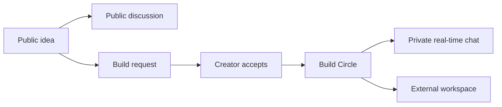

# AllDevs

**Discover an idea. Find collaborators. Build together.**

AllDevs is a GitHub-native collaboration product called **Build Circles**: public ideas, swipe discovery, creator-approved teams, and private real-time chat.

**Status:** Beta foundation implemented locally, not launched. The architecture interview is closed and the 60-second fallback target is selected. Workspace tooling, an empty frontend, local Worker/D1/DO bindings, and foundation tests are available. GitHub login, product features, and working chat are not implemented yet. Vercel costs are user-managed; the zero-spend backend constraint remains.

Updated: 2026-10-15.

- [CONTEXT.md](CONTEXT.md): plain-language product brief, agreed rules, open decisions, and glossary.
- [README.md](README.md): product summary, draft PRD, proposed architecture, costs, and verification plan.

Agreed means decided in discussion. Recommended means a proposal. To Decide means intentionally unresolved. Document consolidation is not implementation approval.

## Product Summary

| Area | Agreed Rule |
| --- | --- |
| Discovery | Swipe on public ideas, not people. Local-first by selected city/metro; no GPS required |
| Remote collaboration | Every idea accepts remote requests; no local-only creator setting |
| Public access | Anyone reads ideas/comments; GitHub sign-in is required to post, comment, or request to join |
| Membership | Right swipe sends a build request. Creator acceptance grants membership |
| Allowance | Only new build requests count, including equivalent forum actions. Views, skips, failed creation, and duplicate retries do not count |
| Coordination | Private built-in real-time circle chat or an external workspace |
| Beta | Free, including chat. No checkout, subscriptions, or paywalls |
| Future premium | Optional extra swipes after beta, not paid chat or circle membership |
| Pilot infrastructure | Cloudflare/backend and other non-Vercel infrastructure remain at USD 0; user handles Vercel plan/costs separately |
| Launch community | Explicitly deferred by the user; decide later |

## Problem Statement

Developers can publish code and ideas, but finding people who want to work on the same thing is a separate problem. GitHub activity and follower counts do not reveal willingness, availability, or fit for a new collaboration.

AllDevs focuses on moving from an idea to an agreed collaboration. Demand, repeat usage, and competitive differentiation are hypotheses, not validated market findings.

## Solution

1. Browse public ideas and discussion without signing in.
2. Use GitHub sign-in to post an idea, comment, or send a build request. Work evidence is optional; no minimum commits, followers, or repositories.
3. Discover ideas local-first, while allowing remote participation in every circle.
4. Swipe right to request collaboration; swipe left to skip without using allowance.
5. Let the creator choose collaborators instead of automatically enrolling everyone interested.
6. Coordinate in free private real-time chat during beta, or choose an external workspace.

**Recommended:** use the same idea posts for forum and swipe views, with accessible button alternatives. Track an agreed first building step, not just swipes. Required post fields and progress features remain open.



## User Stories

Draft stories based on agreed behavior. Safety/recovery stories describe required design considerations; their detailed policies and implementation are not yet approved.

1. As a visitor, I want to read ideas without signing in, so that I can assess the community before joining.
2. As a visitor, I want to read public discussion, so that I can understand an idea's context.
3. As a builder, I want to sign in with GitHub without activity thresholds, so that a new account is not excluded.
4. As a builder, I want to choose which work evidence I share, so that participation does not require a complete public activity history.
5. As a builder, I want to select a city or metro without GPS, so that discovery has local context without precise tracking.
6. As a creator, I want to post an idea without an existing repository, so that collaborators can help shape it early.
7. As a builder, I want to discover nearby ideas first, so that local collaboration is easier to find.
8. As a remote builder, I want to request collaboration on any geographically eligible idea, so that living elsewhere does not block me.
9. As a signed-in builder, I want to comment before joining, so that I can clarify expectations.
10. As a builder, I want to skip without using allowance, so that exploration is not penalized.
11. As a builder, I want a right swipe or equivalent forum action to send a build request, so that I can express interest consistently.
12. As a builder, I want only new requests to consume allowance, so that retries and failures do not charge extra units.
13. As a creator, I want to review and accept collaborators, so that interest is not automatic membership.
14. As a member, I want private real-time circle chat without payment in beta, so that we can coordinate together.
15. As a circle, I want an external coordination option, so that we can use a workspace we prefer.
16. As a member, I want exhausted swipe allowance not to revoke membership or chat, so that existing collaboration continues.
17. As a user, I want clear limit or outage states without a paid beta bypass, so that unavailable capacity is represented honestly.
18. As a member, I want reliable acknowledgment and reconnect behavior, so that I can tell whether a message was saved.
19. As a user, I want visibility, reporting, blocking, correction, and deletion policies, so that I can control my participation and address abuse.
20. As the operator, I want quota-aware controls and measurements, so that the backend stays within its hard-zero pilot budget while Vercel costs are handled separately.

## Implementation Decisions

The product rules, frontend/API/auth/data stacks, same-origin HTTP proxy, per-circle chat, pre-upgrade tickets, and push revocation with bounded lease fallback are agreed. Unless explicitly marked selected, the component details and module boundaries below are **recommended, not selected or implemented**. Test scope and delivery approval are still required.

### Technical Decision Register

Architecture grilling closed on 2026-10-15 at the user's request. Proceed with feature planning and toolchain setup rather than further A/B questions. Record routine engineering defaults explicitly and validate them; do not invent product-policy approvals. Recruitment remains deferred.

| ID | Decision | Current Recommendation | Status |
| --- | --- | --- | --- |
| T1 | Hosting topology | Vercel frontend plus Cloudflare backend | Selected B, 2026-10-15 |
| T1a | Vercel plan and budget | Keep Vercel; the user handles its plan/costs separately from the zero-spend backend | User-managed, 2026-10-15; no specific purchase authorized |
| T2 | Frontend framework and rendering | Next.js App Router with TypeScript; server-render public pages and use client components for swiping/chat | Selected A, 2026-10-15 |
| T3 | API structure and validation | Cloudflare Workers with TypeScript, Hono routing, Zod runtime validation, and REST endpoints in a modular application | Selected A, 2026-10-15 |
| T4 | GitHub login and session ownership | Cloudflare owns the GitHub callback and revocable sessions; frontend consumes that identity | Selected A, 2026-10-15; T4a/T4b select implementation and HTTP routing; policies remain open |
| T4a | Authentication library and session store | Self-hosted Better Auth, GitHub provider, Drizzle SQLite adapter, and D1-backed database sessions | Selected A, 2026-10-15; exact schema/configuration pending |
| T4b | Browser HTTP auth/API routing | Same-origin Vercel proxy to Cloudflare with first-party cookies; WebSocket admission handled separately | Selected A, 2026-10-15; exact proxy/callback configuration pending |
| T5 | Product database | Cloudflare D1 with SQLite relational records and explicit migrations | Selected A, 2026-10-15; exact schema and session integration remain open |
| T5a | Data access and migration tooling | Drizzle ORM D1 adapter for queries; Drizzle Kit generates reviewed SQL; Wrangler applies migrations | Selected A, 2026-10-15 |
| T6 | Chat transport and message storage | Native hibernating WebSockets with one SQLite-backed Durable Object per circle, storing that circle's history | Selected A, 2026-10-15 |
| T6a | Browser WebSocket admission | Short-lived, single-use room ticket issued through authenticated HTTP; validate and consume before upgrade | Selected A, 2026-10-15; wire placement, TTL, and redemption store open |
| T6b | Live chat authorization and revocation | Push revocations to affected rooms, with bounded authorization leases/revalidation as fallback; fail closed when current access cannot be verified | Selected A, 2026-10-15; maximum delay and failure/retry design open |
| T6c | Maximum fallback authorization window | At most 60 seconds of stale access if push invalidation fails; enforce before sends, delivery, and history reads | Selected A, 2026-10-15; enforcement and capacity require tests |
| T7 | Consistency and limits | Atomic request counting, idempotency, authoritative membership, bounded chat usage | Implement and verify in the feature slices; numeric product limits remain configurable and unapproved |
| T8 | Safety and observability | Server-side authorization, abuse controls, privacy-safe logs, quota circuit breakers | Required before live beta; detailed privacy/moderation policies remain launch gates |
| T9 | Tests and delivery | Local toolchain, behavior tests, browser journeys, CI, then staged deployment | Proceed with setup; no claim of launch readiness |

**T1 decision:** The user selected B: frontend on Vercel, backend/API and chat on Cloudflare. The Cloudflare-only recommendation was not selected. T6c now selects a 60-second fallback target; the user has closed the interview and requested delivery planning/setup. Live deployment still requires the launch checklist, and no backend charges are authorized.

**Vercel plan responsibility:** Official documentation checked on 2026-10-15 limits Hobby to personal, non-commercial use; commercial deployments require Pro or Enterprise. The user has stated they can handle Vercel, so retain the chosen host and leave its plan/eligibility/costs with the user. This is not confirmation of Hobby eligibility or authorization for the assistant to activate a paid plan. Verify the applicable plan before deployment without reopening the hosting choice during framework selection.

**T1a decision:** "Can handle Vercel" is recorded as a user-managed exception to the earlier all-in USD 0 target, not an unlimited spending approval. The Cloudflare/backend and other non-Vercel infrastructure remain under the zero-spend pilot constraint. No plan, price, purchase, deployment, or backend overage has been approved.

**T2 decision:** The user selected A: Next.js App Router with TypeScript on Vercel. Server-render public idea pages with per-idea sharing metadata; use client components for swiping, live chat, and other browser interactions. The React/Vite SPA alternative was not selected. Exact package versions, styling, client state tooling, and search-engine indexing policy remain undecided.

**Frontend boundary:** Next.js renders the website and reads Cloudflare APIs; it must not become a second authority for product writes, membership, allowance counting, or sessions. Browser HTTP auth/API calls use the selected same-origin Vercel proxy; Cloudflare owns authentication and pre-upgrade room-ticket admission. Exact cookie/proxy configuration and ticket parameters remain open. Private/member-specific responses must never enter a shared public cache; cache and revalidation policies need explicit design.

**T3 decision:** The user selected A: Cloudflare Workers with TypeScript, Hono routing/middleware, Zod runtime validation, and REST endpoints in one modular API application. The plain fetch-routing alternative was not selected. Keep domain operations separate from route handlers rather than creating a microservice fleet. TypeScript types alone do not validate untrusted JSON, and schema validation does not replace authorization. This does not select an auth library, database layer, chat protocol, or exact dependency versions.

**T4 decision:** The user selected A: Cloudflare owns GitHub OAuth callback handling, session creation/validation/revocation, and the identity used by API and chat admission. Next.js consumes that identity rather than creating an independent session authority. Next.js-owned authentication was not selected. This is an ownership decision, not selection of an auth library, session database, token format, cookie topology, or expiry policy.

**Auth integration still to design:** Better Auth, D1-backed sessions, and a same-origin HTTP proxy are selected; exact schema, GitHub app/scopes, expiry, logout, preview callbacks, cookie configuration, and origin checks remain open. The beta does not rely on third-party cookies between unrelated Vercel/Workers domains or require a new shared custom domain. Documented library support still requires runtime tests. OAuth tokens must stay server-side, and chat needs separately authenticated admission plus live-access revocation.

**T5 decision:** The user selected A: Cloudflare D1 for profiles, ideas, public comments, requests, memberships, and allowance records. Use relational constraints and explicit migrations; Workers access D1 through its native binding. MongoDB Atlas was not selected for product storage. This does not select the query library, auth adapter/session schema, or chat history storage, and does not establish free-tier capacity.

**D1 constraints checked on 2026-10-15:** Workers Free permits 500 MB per D1 database, 5 GB total account storage, 5 million rows read/day, and 100,000 rows written/day. A database processes queries one at a time; indexed queries, bounded scans, atomic request/allowance operations, and overload handling need validation. Index maintenance adds writes; exhausting read/write quotas causes query errors, not an unlimited free service. T6 selects per-circle Durable Object SQLite chat history, not duplicate message writes into D1. T4a selects D1-backed sessions; their lookups/refreshes and auth tables must be included in the same quota/storage budget and migration review.

**T5a decision:** The user selected A: Drizzle ORM with its D1 adapter for typed schema/query code, Drizzle Kit for generated SQL migrations, and Wrangler as the single migration application authority. Native prepared SQL with hand-written migrations was not selected as the primary data-access approach. Drizzle does not replace Zod input validation, authorization, database constraints, or query-plan review.

**Selected migration workflow:** generate SQL with Drizzle Kit, review it, apply it to local/test D1, verify behavior, and apply the same versioned files to the intended remote database only after deployment approval. Use one applied-migration history, managed by Wrangler, rather than also applying the same migrations through Drizzle's separate runner. Match Wrangler's migration directory/pattern to the generated layout. Do not use direct schema push as an unreviewed production migration path. Exact versions, schema, scripts, CI, and deployment approvals remain open. An RC example in upstream docs is not approval to adopt prereleases. Atomic multi-write operations must be verified with the actual D1 adapter; do not assume generic ORM transaction APIs have identical runtime support.

**T4a decision:** The user selected A: self-hosted Better Auth for GitHub sign-in and D1-backed database sessions through the Drizzle SQLite adapter, running on Cloudflare. The Arctic plus application-managed session alternative was not selected. This is a library selection, not a paid authentication service or a claim of unlimited free capacity. Passwords, other providers, organizations, and billing are not added to beta.

**Auth compatibility evidence, checked on 2026-10-15:** Better Auth documents mounting its handler in Hono, Workers compatibility for AsyncLocalStorage, a Drizzle SQLite adapter, GitHub sign-in, and database-backed session management. These documented pieces are not a tested AllDevs integration. Before shipping, pin compatible versions and verify Workers runtime flags, D1 adapter transaction behavior, generated auth schema, GitHub callback/email handling, login/logout/revocation, and actual origins/cookies. Any generated auth schema must feed the selected Drizzle Kit-to-Wrangler migration path, not a second application runner.

**Session policy still open:** duration, refresh/write frequency, IP/user-agent retention, provider scopes/token retention, and exact cookie/proxy configuration require decisions. T6b selects pushed room invalidation with bounded revalidation; its timing and reliable propagation design remain open. Cookie caching can delay revocation, so sensitive checks must not bypass the eventual freshness bound. Never place GitHub provider tokens in browser-accessible state or public logs. Library/store/routing selection does not automatically decide these policies.

**T4b decision:** The user selected A: browser HTTP auth/API calls go through a narrowly scoped same-origin Vercel proxy to Cloudflare, with first-party session cookies. Shared-parent app/API domains were not selected as the beta requirement. Cloudflare still runs the only Better Auth instance, owns callback/session handling, and validates sessions; the proxy is not a second auth server. This avoids depending on third-party cookies without requiring a newly purchased domain. Exact rewrites/proxy implementation, cookie attributes, callbacks, and preview-origin policy still need design and tests.

**Routing evidence and implementation gate:** Better Auth's cookie documentation describes both reverse proxies and shared-parent domains to avoid Safari ITP issues. A proxy must preserve cookie/redirect behavior, use a fixed trusted upstream, configure the public auth base/callback URLs correctly, validate origins/CSRF, and avoid trusting arbitrary forwarded headers. Never publicly cache auth/private responses. Preview origins need an explicit policy; proxy latency and Vercel usage must be measured rather than assumed free.

**WebSocket boundary:** chat runs on Cloudflare; the selected HTTP proxy does not carry long-lived chat sockets. T6a selects short-lived single-use tickets consumed before upgrade, and T6b selects pushed revocation plus bounded fallback for connected access. Do not send the long-lived Better Auth session credential or GitHub token in the WebSocket URL. Ticket parameters, maximum fallback window, and reliable revocation propagation still require design.

**T6 decision:** The user selected A: native WebSockets using Cloudflare's Hibernation API, with one SQLite-backed Durable Object per circle owning live room coordination and message history. Central D1 history was not selected. D1 retains product records, membership, and sessions; do not duplicate every chat message there. This does not select admission credentials, the room's SQL access library, schema, retention, message protocol, limits, or revocation policy.

**Proposed chat contracts, not approved implementation:** persist a message before acknowledging it as saved, scope reads/writes to the circle, deduplicate retries, order messages with a server-owned cursor, paginate history, and recover after socket disconnects. Room membership/session authorization stays tied to the Cloudflare authority, with revocation propagation designed explicitly. Hibernation saves idle-room duration but does not make active handling or retained history free. Its in-memory state is reset when an object hibernates; connection attachments can preserve metadata only while that connection survives, not durable history. Deployments can disconnect sockets. The message schema, SQL access layer, ticket parameters, retention, limits, and recovery/revocation policy remain open despite transport/admission selection.

**T6a decision:** The user selected A: obtain a short-lived, single-use room ticket via authenticated HTTP and validate/consume it before accepting the direct Cloudflare WebSocket upgrade. First-message authentication was not selected. Minting and redemption must check current session/membership and reject expired, replayed, revoked, or wrong-room access. This chooses admission timing and ticket scope/single use, not exact TTL, format, wire placement, redemption storage, or the live-socket revocation policy.

**Admission constraints, checked on 2026-10-15:** the browser WebSocket constructor accepts a URL and optional subprotocols, not arbitrary Authorization headers. For the selected ticket flow, minting must validate session, membership, origin, and rate limits; redemption must bind user/session/room and enforce expiry and atomic single use. Upgrade metadata can be logged, so ticket placement and redaction need explicit review. Reconnects need fresh authorization rather than reusing a consumed ticket. The actual credential format, wire placement, TTL, redemption store, expiry handling, and live-socket revocation are still unapproved; admission alone does not keep an existing connection authorized forever.

**T6b decision:** The user selected A: push session/membership invalidation to affected rooms, backed by bounded authorization leases/revalidation, with fail-closed handling when current access cannot be verified at the refresh boundary. Lease-only handling was not selected. Invalidation must stop sends, receipt of new room events, and history reads, not merely prevent reconnecting. T6c selects the 60-second fallback target; reliable signaling, retries, and end-to-end enforcement still need implementation and tests.

**Selected revocation pattern; implementation details open:** the session/membership authority records the change and signals affected rooms. A room closes or disables matching access when invalidation arrives. An expired lease permits no new sends, history reads, or outbound room data until current access is verified; an unavailable authority fails closed at that boundary. Design durable pending invalidation, idempotent retries, failure recovery, and ordering because D1 and room storage are not one atomic transaction. Failed signals can leave bounded stale access, so do not promise zero-latency global revocation. An idle socket remaining physically open after lease expiry is not permission to release data; do not keep every room awake with polling timers. Hibernation metadata, active-session tracking, delivery races, and enforcement need tests before making a bound guarantee.

**T6c decision:** The user selected A: at most 60 seconds of fallback stale access when pushed invalidation fails. Five minutes was not selected. This is a chat authorization-freshness target, not a login/session lifetime or a measured free-tier capacity. Enforcement, races, failures, and resource use must be tested before making a production guarantee.

**Enforcement design to verify:** measure freshness from the authoritative access check's start, cap leases at 60 seconds and session expiry, and enforce expiry before inbound writes, history reads, and outbound delivery. Do not renew from an older replica/cookie-cache result or extend access while verification is unavailable. Define in-flight races explicitly; the bound applies to real access, not just a timer. Check leases on activity to preserve idle hibernation. Benchmark D1/session reads and fan-out before claiming the target fits the zero-spend pilot.

### Component Plan

| Responsibility | Candidate | Boundary |
| --- | --- | --- |
| Frontend | Next.js App Router with TypeScript on Vercel, selected; plan/costs user-managed | Public server-rendered pages plus client-side forum interactions, discovery, review, and chat UI |
| Product API | TypeScript Cloudflare Workers with Hono, Zod, and REST, selected | Ideas, comments, requests, membership, and allowance operations; D1 selected, detailed contracts open |
| GitHub authentication | Cloudflare-owned Better Auth with GitHub/D1 sessions and same-origin HTTP access, selected | Pre-upgrade tickets, pushed revocation, and 60-second fallback target selected; real login, schema, scopes, cookie settings, and propagation not implemented |
| Product records | Cloudflare D1 with Drizzle ORM, selected | Profiles, ideas, public comments, requests, membership, and allowance state; exact schema open |
| Schema and migrations | Drizzle Kit generation plus Wrangler application, selected | Reviewed versioned SQL and one applied history; exact versions, scripts, schema, and CI pending |
| Browser HTTP access | Same-origin Vercel proxy to Cloudflare, selected | Fixed upstream and first-party cookies; exact OAuth/callback/preview/proxy behavior needs tests; not chat socket proxying |
| Real-time rooms/history | Native hibernating WebSockets and per-circle SQLite-backed Durable Objects, selected | Local binding exists but deliberately rejects chat; message storage, admission, revocation, and retention still require implementation |
| Socket admission | Short-lived single-use room ticket obtained through authenticated HTTP and checked before upgrade, selected | Wire format, TTL, store, and rate limits open; live authorization pattern selected separately |
| Live authorization | Pushed room invalidation plus bounded authorization leases/revalidation, selected | 60-second helper is unit-tested; no live-room enforcement yet. Durable retry, race handling, and operational validation pending |
| Abuse protection | Turnstile plus application limits | Not a substitute for authorization or moderation |
| Optional GitHub enrichment | Queues and bounded scheduled work, only if needed | Fetch approved public evidence; do not crawl a global developer census |

GCP remains an alternative for a demonstrated future need; MongoDB Atlas was evaluated and not selected for product storage. KV, R2, AI, semantic search, and extra services should be added only for a demonstrated need and a reviewed cost. No provider accounts, deployment, paid plans, or charges have been authorized.

**Split-host design to resolve:** HTTP calls use the selected same-origin proxy. Decide exact production/preview origins, fixed upstream and proxy paths, public callback URLs, cookie/session attributes, CSRF/origin rules, and authenticated WebSocket admission. The frontend must not create an independent membership or session authority. Browser chat is planned to connect to Cloudflare separately; no long-lived Vercel socket proxy or third-party-cookie solution has been approved.

### Proposed Modules

These are ownership boundaries, not a requirement for separate microservices.

| Module | Encapsulated Behavior |
| --- | --- |
| Identity and Profile | GitHub account linkage, sessions, selected evidence, and profile visibility |
| Ideas and Public Discussion | Idea records, discovery queries, and public commenting permissions |
| Requests and Allowance | Request creation, deduplication, consistent counting, and eventual reset/limit rules |
| Circle Membership | Creator acceptance and permissions; later departure/removal/capacity rules |
| Circle Chat | Room access, saved-message acknowledgments, fan-out, history, and reconnect recovery |
| Safety and Operations | Reporting, blocking, deletion propagation, quota controls, and observability |

### Important Contracts

- Public commenting, requesting membership, and membership itself are different permissions.
- Membership is checked server-side for chat connections, sending, and history. Removal/session expiry must revoke existing access, not just hide a button.
- Request creation and allowance consumption must succeed together; failures and duplicate retries cannot consume extra units. Forum and swipe interfaces cannot bypass the same rule.
- Message persistence is distinct from delivery. A failed save must not be acknowledged as saved; reconnects need deduplication and catch-up behavior.
- Beta has no billing code, subscription checks for chat, or paid limit bypass.
- GitHub credentials stay server-side. Permissions, session expiry, CSRF, origin checks, and any cross-host cookie/CORS design require review; CORS alone is not authorization.
- Deletion must cover derived views, caches, history, and queued reimport. Retention and backup expiry need policy decisions.

## GitHub Data and Reference Lessons

GitHub supplies sign-in and optional work context, not a score of professional worth. Suitable evidence could include selected public repositories, topics/languages, pull requests, reviews, documentation, or releases, with source links and observation times. Do not infer competence, sensitive traits, exact location, or availability from counts or timestamps.

Public data is not unrestricted personal data. Define import/publication consent, correction, visibility, block/report, deletion, and do-not-reimport behavior. No private-repository ingestion, email harvesting, unsolicited outreach, or personal contact-list sales. Public ideas do not transfer ownership, grant a code license, or promise confidentiality. These are launch-review requirements, not legal approval.

If enrichment is selected:

- Use stable GitHub IDs; account renames, deletions, and visibility changes need explicit handling.
- Search returns up to 1,000 results per query and can be incomplete. A discovered cohort is not all developers.
- GraphQL generally has 5,000 points/hour per user, but authentication and installation context change budgets. Nested-query resource limits, secondary limits, and timeouts can bind earlier.
- REST search limits are endpoint-specific; the documented REST user-search endpoint does not accept authentication. Validate endpoint/credential behavior instead of assuming a generic quota.
- Use permitted webhooks for installed repositories, not an assumed global event stream. Respect retry guidance; never pool tokens or rotate accounts to evade limits.

The inspected adjacent Committers.top collector combines follower-sorted discovery with expensive contribution queries. It currently uses two users per page to avoid resource errors: 1,000 edges require at least 500 successful requests. Retries can restart discovery; follower-threshold windows may miss ties and need a coverage fixture. This is source analysis, not a benchmark or a change to that project.

**Recommended improvement:** separate discovery, bounded enrichment, durable progress, and cached serving. Compare equal fields, freshness, and coverage before claiming a speedup. AllDevs' first-party idea/collaboration workflow does not require this full collector.

Security note: the reference README contains a token-shaped example. If genuine, its owner should revoke/rotate it. It has not been reused, tested, or copied here.

## Chat and Cost Plan

**Agreed:** free beta for users; hard USD 0 Cloudflare/backend and other non-Vercel pilot infrastructure spend, with proactive throttling/pausing rather than paid upgrades. Vercel plan/costs are handled separately by the user. Alerts alone are not spending caps. Future revenue, temporary credits, or a free allowance do not authorize charges or establish sustainable capacity.

### Provider Comparison

Official documentation checked on 2026-10-15; confirm again before deployment.

| Candidate | Relevant Free Allowances | Caveat |
| --- | --- | --- |
| Vercel frontend | Hobby is free only for eligible personal, non-commercial projects; resource allowances and pause rules apply | Host retained; the user handles the appropriate plan/costs. No assumption of Hobby eligibility or specific paid-plan approval |
| Cloudflare D1, selected product database | 500 MB per free database; 5 GB total account storage; 5 million rows read/day and 100,000 rows written/day | Query scans and indexes consume quotas; eventual session traffic must be budgeted too. No supported capacity or automatic paid upgrade |
| Cloudflare SQLite-backed Durable Objects | 100,000 requests/day; 13,000 GB-s duration/day; 5 million SQL rows read/day; 100,000 rows written/day; 5 GB account storage | Available on Workers Free; Workers/D1 have separate limits. These are not per-room or supported-user counts. Exhausted free quotas can fail operations |
| GCP Cloud Run, request-based billing | 180,000 vCPU-seconds; 360,000 GiB-seconds; 2 million requests/month, subject to documented regional pricing rules | Active long-lived requests consume compute; transfer, builds, image storage, and supporting services may cost extra |
| MongoDB Atlas Free | 0.5 GB storage including indexes; 500 database connections; 100 operations/second; rolling seven-day transfer limits of 10 GB each direction | Database capacity, not WebSocket hosting or 500 chat users. No managed backups or automatic storage expansion |

Cloudflare is the first recommended candidate to measure. Its optional USD 5/month paid Workers plan is not inherently required for SQLite-backed Durable Objects on Workers Free and is not an approved purchase. Frontend, database, logs, storage, email, domains, and every other service need separate review.

### Keeping Real-Time Chat Efficient

- Use WebSocket Hibernation so idle rooms can keep clients connected without continuous active-room duration. Timers, pending work, and non-hibernating sockets can defeat it.
- Hibernation does not remove active processing or storage usage. The documented 20:1 incoming-message billing ratio is not a SQL-write discount or capacity guarantee.
- Outgoing frames have no Durable Object request charge, but fan-out and slow receivers still consume work. Bound connections, message sizes, room size, history reads, and retention.
- Store message history once where justified; avoid duplicating each message across databases without a need.
- Reconnects and deployments can interrupt sockets. Design recovery instead of promising uninterrupted or exactly-once delivery.
- Keep API limits, retention, quota headroom, observability, and failed-send states explicit. Never report an unsaved message as saved.

**Illustration, not an approved workload:** 500 daily users sending 20 messages each means 10,000 messages/day. At three stored-row writes per message, that is about 30,000 writes/day; at 1 KB per message, 30 days is about 300 MB before indexes/metadata. Duration, fan-out, reads, connection churn, and abuse may exhaust another quota first. No free-capacity claim has been measured.

Before sizing the pilot, agree on daily users, peak connections, active circles, messages/day and peak rate, message size, fan-out, history reads, retention, and acceptable interruption. The launch community remains deferred; no numeric capacity or request limit is approved.

## Beta Delivery Plan

The question-by-question interview is finished. Deliver complete, testable slices in this order; do not call a scaffold or a health endpoint a launched product.

| Phase | Features or Tools | Exit Check |
| --- | --- | --- |
| 1. Foundation | Workspace layout, pinned dependencies, Next.js frontend, Hono Worker, shared validation/contracts, Drizzle config, local D1/DO tooling, lint/typecheck/tests/build, CI | Fresh install and local checks pass; web and API start without real credentials; no secrets committed |
| 2. Identity | Better Auth GitHub login, reviewed auth schema/migrations, same-origin HTTP proxy, session/logout/revocation | Real OAuth callback works in a controlled environment; unauthorized requests fail; private data is not cached |
| 3. Ideas and Discussion | Post/edit ideas, public list/detail/comments, locality context, swipe view and equivalent buttons | Creator and visitor journeys work; input and ownership checks pass |
| 4. Collaboration | Build requests, one-count-per-new-request allowance, creator review, circle membership, external workspace option | Duplicate/concurrent requests cannot bypass limits; no accidental membership or private-link disclosure |
| 5. Private Chat | Per-circle SQLite history, native hibernating sockets, single-use tickets, acknowledgments/reconnect, pushed revocation and 60-second fallback | Multi-client room test plus unauthorized/replay/wrong-room/removal/logout/expiry/failure tests pass |
| 6. Safe Beta | Reports/blocks/deletion, retention, configurable usage caps, quota monitoring, load checks, rollback/runbook, provider configuration | Launch checklist below is complete; beta remains free with no paid bypass |

**Working implementation defaults:** use the existing chosen stack and a small modular workspace, not additional services or microservices. Choose tool versions and local scripts during setup. Unresolved numerical limits, retention periods, public indexing, invitation policy, and account/privacy rules remain explicit launch gates, not hidden assumptions. No recruitment questions are needed to prepare the codebase.

### Beta Launch Checklist

- [ ] Phases 1-5 work end to end with real GitHub login and at least two test accounts.
- [ ] Private chat/history, ticket replay, membership removal, logout, expiry, and the 60-second fallback pass security/failure tests.
- [ ] Request allowance is atomic across all interfaces; operational caps and retention are configured and disclosed.
- [ ] Reporting, blocking, correction/deletion, moderation ownership, and privacy/terms text are ready.
- [ ] Cloudflare account/Workers/D1/DO access is available and the zero-spend enforcement strategy is verified; no paid plan is silently enabled.
- [ ] Vercel project/plan and exact public URLs are configured by an authorized account; previews cannot access production sessions/data accidentally.
- [ ] GitHub OAuth application and secrets are configured directly with providers, not pasted into chat or committed to Git.
- [ ] Migrations, CI, load checks, redacted logs, dependency security review, deployment verification, and rollback procedures pass.
- [ ] Publish only after the above gates; record the actual deployment URLs and verified state. Until then, status is preparation, not launched.

## Local Development

Use Node.js 24 LTS as recorded in [.nvmrc](.nvmrc). The foundation was also tested locally with Node.js 26.5.0 and npm 11.17.0. Dependencies are pinned in workspace manifests and locked in [package-lock.json](package-lock.json).

```bash
npm ci
npm run dev
```

- Frontend: http://127.0.0.1:3100
- Worker: http://127.0.0.1:8787/api/health
- Same-origin proxy: http://127.0.0.1:3100/api/health

The preview is intentionally empty. GitHub sign-in is disabled. The health contract returns `stage: foundation` and `betaReady: false`; auth routes return 503, unknown feature routes return 404, and the room binding rejects chat with 503. These are fail-closed placeholders, not a working beta.

| Command | What It Does |
| --- | --- |
| `npm run dev` | Starts the local Worker and Next.js app together |
| `npm run check` | ESLint, generated Worker/Next types, TypeScript checks, and foundation tests |
| `npm run build` | Worker dry-run bundle and production Next.js build; no upload/deployment |
| `npx playwright install chromium` | Installs the local browser used by smoke tests |
| `npm run test:e2e` | Starts disposable local servers and checks desktop/mobile rendering and the HTTP proxy |
| `npm run db:generate` | Generates SQL from the schema; currently reports zero feature tables |
| `npm run db:migrate:local` | Applies migrations to local-only D1; currently has no feature migrations |

### Workspace Map

- [apps/web/package.json](apps/web/package.json): Next.js frontend and its pinned dependencies.
- [apps/api/package.json](apps/api/package.json): Hono Worker, Better Auth/data dependencies, Wrangler, and Worker test tooling.
- [apps/api/wrangler.jsonc](apps/api/wrangler.jsonc): local D1 and SQLite-backed room bindings. The all-zero database ID is a placeholder, not a provisioned remote database; public Workers/preview URLs are disabled.
- [packages/contracts/src/index.ts](packages/contracts/src/index.ts): shared health validation and the 60-second freshness helper.
- [tests/e2e/foundation.spec.ts](tests/e2e/foundation.spec.ts): desktop/mobile shell and HTTP proxy smoke tests.
- [.github/workflows/ci.yml](.github/workflows/ci.yml): manual foundation CI. Automatic push/PR triggers are intentionally not enabled before runner/quota costs are reviewed.

### Environment and Safety

The frontend's server-only `API_ORIGIN` defaults to the local Worker. [apps/web/.env.example](apps/web/.env.example) documents it. [apps/api/.dev.vars.example](apps/api/.dev.vars.example) lists the future GitHub/auth variables with blank secret values. No real credentials or production IDs were created, read, or committed.

Remote setup needs an authorized Cloudflare account, real D1/DO configuration, Vercel project/URLs, and a GitHub OAuth application. Configure secrets directly in local/provider secret stores, never in chat or source control. The chosen HTTP proxy still needs real callback/cookie tests. No remote migration or deployment command is part of the verified setup flow.

### Verification and Known Risks

Verified foundation checks: lint/typecheck, nine shared/Worker tests, four desktop/mobile browser tests, Worker dry-run and Next.js production builds, Drizzle config/schema loading, and local-only migration execution. This does not verify OAuth, product workflows, active chat, or production capacity.

Dependency audit on 2026-10-15 reports nine advisories: four moderate in the legacy Drizzle Kit/esbuild loader chain, and five high in the Next.js lint/glob chain. The production-filtered report includes the four moderate loader findings through the installed peer graph. A scoped override was tried, verified ineffective in the resolved tree, and removed; no forced downgrade or pretend remediation remains. Review compatible upstream fixes/mitigations before release. Do not expose development/tooling servers publicly or treat this setup as security-cleared beta software.

## Testing Decisions

The foundation uses Vitest 4.1.11, the current Cloudflare Vitest plugin for local Workers/D1/DO execution, Playwright Chromium desktop/mobile smoke tests, ESLint, and TypeScript. Use observable module contracts and end-to-end journeys, not implementation details. The matrix below remains the feature-level beta acceptance plan, not a claim that every behavior is implemented or tested.

| Area | Behavior to Verify |
| --- | --- |
| Identity/access | Public reads, GitHub-required writes, minimum permissions, session expiry, and no activity threshold |
| Discussion/membership | Commenting does not request or grant membership; creator acceptance gates private access |
| Request allowance | One unit per new request; zero for views, skips, failed creation, or duplicate retries; consistent forum/swipe behavior; concurrent limit/reset cases |
| Chat | Private room/history authorization, live-socket revocation, persistence acknowledgments, duplicate sends, reconnect catch-up, deployment disconnects, and backpressure |
| Beta constraints | No checkout/paywall, no chat subscription check, no membership loss from exhausted allowance, and no paid bypass |
| Safety/deletion | Block/report behavior, account renames/revocation, deletion during queued work, cache invalidation, and eventual retention policy |
| Operations | Agreed-load benchmarks, bursts, hibernation, quota exhaustion/recovery, resource amplification, and hard-zero enforcement |

Unresolved lifecycle/retention rules must be recorded as explicit working defaults or release gates, not silently invented. End-to-end revocation, load, privacy, moderation, and deletion testing belongs to the feature phases; the foundation freshness helper alone does not prove the live 60-second bound.

## Out of Scope

**Confirmed beta exclusions:** checkout, subscriptions, payment collection, and premium paywalls. Future premium is extra swipes after beta, not paid chat, paid circle membership, or guaranteed acceptance.

Other unapproved directions: global developer census, universal developer scoring, private-repository ingestion, recruiter contact exports, dating, unrelated social feeds/DMs, voice/video, attachments, AI matching, presence, typing indicators, read receipts, and push notifications. Text-first chat is recommended, not an approved detailed chat spec.

## Further Notes

### Deferred Decisions

| Topic | Status |
| --- | --- |
| Launch city/community and recruitment | Deferred by the user, 2026-10-15; no further recruitment questions for now |
| Invite policy, cohort size, timeline, and interview audience | To decide |
| Idea fields, filters/ranking, skips/undo, and request visibility | To decide |
| Numeric allowance, reset/rollover, and withdrawal/rejection refunds | To decide |
| Request expiry, team capacity, member leaving/removal, and creator succession | To decide |
| Chat scope, history, retention, exports, deletion, moderation, and external-link visibility | To decide |
| Profile consent/visibility, contact rules, indexing, and policy review | To decide before launch |
| Workload, safety margins, outage/recovery behavior, and success thresholds | To measure/decide |
| Hosting split | Vercel frontend plus Cloudflare backend selected; the user handles Vercel plan/eligibility/costs before deployment |
| Frontend framework | Next.js App Router/TypeScript scaffold and local shell available; styling/client state for real features and indexing policy remain open |
| API framework | TypeScript Workers/Hono/Zod/REST foundation available; product/auth endpoints not implemented |
| Authentication | Better Auth with GitHub, Drizzle/D1 sessions, and same-origin HTTP proxy selected; exact configuration, scopes, expiry, and revocation policy open |
| Product data access | D1/Drizzle/Kit/Wrangler tooling pinned and checked; feature/auth schema and real session integration still pending |
| Chat transport/history | Hibernating native WebSockets plus one SQLite-backed Durable Object per circle selected; room schema, SQL library, retention, and protocol open |
| Socket admission | Short-lived single-use room ticket validated/consumed before upgrade selected; TTL, format, wire placement, and redemption store open |
| Live authorization | Push invalidation plus at most 60-second fallback selected; helper tested, room enforcement/recovery/race testing pending |
| Delivery | Foundation set up locally; feature implementation and launch checklist remain incomplete |
| Future premium price, packaging, payment fees, and beta-exit criteria | Post-beta; no billing implementation now |

External coordination is not guaranteed to be free. AllDevs cannot revoke copied third-party invites without an approved integration. Running out of future paid swipes must not become a chat paywall. Future monetization needs unit-economics and payment/legal review; it does not authorize infrastructure spending.

### Validation and Interview Evidence

Recommended product outcome: circles that reach an agreed first working session or verifiable building outcome. Supporting metrics: useful comments, requests/acceptance, time to first collaborator, returning users, and abuse reports. Targets are undecided; GitHub activity alone cannot attribute successful collaboration.

Recommended validation: interview a small consenting cohort and manually facilitate collaboration before making demand claims. A suggested 20-50 builders is not an approved signup cap. Compare GitHub-native workflows, community groups, portfolio tools, and contributor-discovery products before claiming uniqueness.

A credible interview story combines user evidence, scope trade-offs, privacy controls, measured latency/freshness/cost, failure recovery, and honest limitations. It cannot guarantee interview success. Never boost the creator's ranking or imply that GitHub counts determine professional worth.

### Decision History

Earlier questions are consolidated here instead of repeated as an interview transcript.

| Decision | Resolution |
| --- | --- |
| Initial product | Build Circles, not a commit leaderboard or profile-first Builder Match |
| Right swipe | Creator-reviewed request, not automatic joining; the user's earlier assent was recorded explicitly |
| Locality | Selected city/metro, local-first and remote-friendly |
| Remote restrictions | Always remote-friendly; per-idea local-only option not selected |
| Participation | GitHub sign-in; no contribution/follower/repository threshold |
| Public discussion | Anyone reads; signed-in users comment without membership |
| Coordination | Built-in real-time circle chat; external option also available |
| Budget | Hard-zero backend/non-Vercel pilot; Vercel plan/costs separately user-managed |
| Premium correction | Future extra swipes, not paid chat or circle sponsorship; free beta with no billing |
| Swipe counting | New build requests only, across interfaces; numeric/reset rules remain open |
| Recruitment | Decide later; documentation consolidation requested instead of more interview questions |
| T1 hosting | Vercel frontend plus Cloudflare backend selected B; user will handle Vercel rather than revisit hosting. No specific paid purchase approved |
| T2 frontend | Next.js App Router with TypeScript selected A; public server rendering and client-side swipe/chat; product rules remain on Cloudflare |
| T3 API | TypeScript Cloudflare Workers with Hono, Zod, and REST selected A; modular API, not microservices. T4 records session ownership; auth integration remains open |
| T4 authentication | Cloudflare session ownership selected A; T4a resolves library/storage and T4b selects HTTP routing. Session policies remain open |
| T5 database | Cloudflare D1 selected A for relational product data; MongoDB Atlas not selected. T5a resolves tooling; session schema and chat history remain separate choices |
| T5a data tooling | Drizzle ORM, Drizzle Kit SQL generation, and Wrangler migration application selected A; one applied-migration history |
| T4a auth implementation | Self-hosted Better Auth with GitHub, Drizzle SQLite adapter, and D1-backed database sessions selected A; T4b selects HTTP routing, while exact configuration and session policies remain open |
| T4b HTTP routing | Same-origin Vercel-to-Cloudflare HTTP proxy selected A; no second auth authority, new-domain requirement, or chat WebSocket proxy selected |
| T6 chat | Native hibernating WebSockets and per-circle Durable Object SQLite history selected A; D1 holds product/membership/session records, not duplicate messages |
| T6a admission | Short-lived, single-use room ticket through authenticated HTTP, validated/consumed before WebSocket upgrade, selected A; exact ticket parameters and live revocation remain open |
| T6b revocation | Push room invalidation plus bounded revalidation selected A; enforce sends/receives/history, fail closed at refresh boundary. No instant-global-revocation claim |
| T6c and execution | 60-second fallback selected A; user ends questions and requests feature planning/tool setup/beta progression. Foundation implemented, beta not launched |

Other explored directions were Contribution Concierge, Maintainer Help Exchange, Proof-of-Work Passport, Repo Rescue, Developer Atlas, Dependency Neighbors, Hackathon Team Draft, and Developer Dating. They are not additional MVP commitments. No market research, name availability, or trademark check established superiority or uniqueness.

### Approval and Project State

Phase 1 foundation is available locally. Phases 2-6 remain: real identity, ideas/discussion, requests/membership, private chat, and safety/release operations. No live product, production database, OAuth application, cloud deployment, or load result exists yet. Continue with the identity/schema slice next rather than more architecture questions. The beta launch checklist remains the release gate; backend charges are still unauthorized. This plan has not been published to an issue tracker, and no commit or push was made by the assistant.

## Sources

GitHub and initial Cloudflare documentation were reviewed on 2026-10-14; chat pricing/limits, alternative providers, and Vercel plan terms on 2026-10-15. Pricing, quotas, and endpoint behavior can change. General policies are not product-specific legal approval. Collector observations refer to the adjacent local Committers.top project, not a performance benchmark or a guarantee about current upstream behavior.

- [Committers.top upstream project](https://github.com/ashkulz/committers.top)
- [GitHub GraphQL rate and query limits](https://docs.github.com/en/graphql/overview/rate-limits-and-query-limits-for-the-graphql-api)
- [GitHub REST search endpoints](https://docs.github.com/en/rest/search/search)
- [GitHub acceptable-use and information-usage policies](https://docs.github.com/en/site-policy/acceptable-use-policies/github-acceptable-use-policies)
- [GitHub API terms](https://docs.github.com/en/site-policy/github-terms/github-terms-of-service#h-api-terms)
- [Cloudflare Workers and related service pricing](https://developers.cloudflare.com/workers/platform/pricing/)
- [Durable Objects free allowances and pricing](https://developers.cloudflare.com/durable-objects/platform/pricing/)
- [Durable Objects limits](https://developers.cloudflare.com/durable-objects/platform/limits/)
- [WebSocket Hibernation and deployment disconnects](https://developers.cloudflare.com/durable-objects/best-practices/websockets/)
- [GCP Cloud Run pricing](https://cloud.google.com/run/pricing)
- [MongoDB Atlas Free cluster limits](https://www.mongodb.com/docs/atlas/reference/free-shared-limitations/)
- [Vercel Hobby plan and usage pauses](https://vercel.com/docs/plans/hobby)
- [Vercel fair-use and commercial-use restrictions](https://vercel.com/docs/limits/fair-use-guidelines)
- [D1 database and account limits](https://developers.cloudflare.com/d1/platform/limits/)
- [D1 free allowances and quota-exhaustion behavior](https://developers.cloudflare.com/d1/platform/pricing/)
- [Drizzle D1 adapter](https://orm.drizzle.team/docs/connect-cloudflare-d1)
- [Drizzle Kit migration generation](https://orm.drizzle.team/docs/kit-overview)
- [Wrangler-managed D1 migrations](https://developers.cloudflare.com/d1/reference/migrations/)
- [Better Auth Hono and Workers integration](https://www.better-auth.com/docs/integrations/hono)
- [Better Auth Drizzle adapter](https://www.better-auth.com/docs/adapters/drizzle)
- [Better Auth GitHub provider](https://www.better-auth.com/docs/authentication/github)
- [Better Auth sessions and revocation/cache caveats](https://www.better-auth.com/docs/concepts/session-management)
- [Better Auth cookies, Safari ITP, reverse proxies, and shared-parent domains](https://www.better-auth.com/docs/concepts/cookies)
- [Better Auth Next.js session-consumption caveats](https://www.better-auth.com/docs/integrations/next)
- [Browser WebSocket constructor and credential-transport constraints](https://developer.mozilla.org/en-US/docs/Web/API/WebSocket/WebSocket)